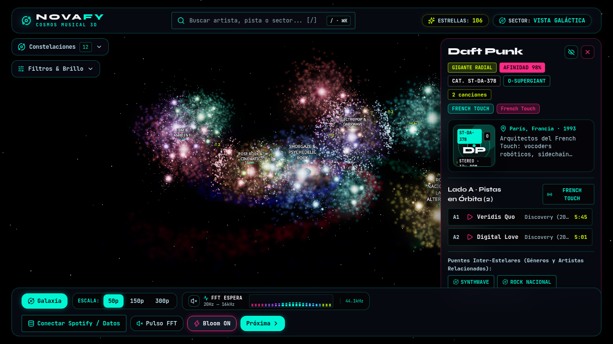

<picture>
  <source media="(prefers-color-scheme: dark)" srcset="assets/banner-dark.svg">
  
</picture>

Software developer based in Rosario, Argentina. I build interactive web applications with TypeScript, React and Three.js, and I'm studying Software Development at Terciario Urquiza, where I work with C and Python.

Open to junior and semi-senior roles, internships and technical collaborations.

## Featured projects

### Novafy

Turns a music library into a navigable 3D galaxy: artists, songs and genres appear as stars and nebulae that react to audio in real time. It connects to Spotify through OAuth 2.0 with PKCE, and you can try it without an account.

**Built with:** Next.js, React, TypeScript, Three.js, React Three Fiber, GLSL, Web Audio API, GSAP

[Live demo](https://your-music-visualizer.vercel.app) · [Source code](https://github.com/leann027/YourMusicVisualizer)

### Portfolio

A catalog of my projects with filters, technical write-ups and diagrams generated in code. A Python pipeline validates the data before each build, and GitHub Actions runs the tests and deploys the site.

**Built with:** React, TypeScript, Vite, Tailwind CSS, Python, Vitest, axe-core

[Source code](https://github.com/leann027/Portfolio)

### AlgoNotebook

A browser-based visualizer for data structures and algorithms. It runs 30 algorithms step by step and highlights the active line in C or Python, along with local variables and the call stack.

**Built with:** TypeScript, C, Python, PWA

Private repository for now.

## Tech stack

<picture>
  <source media="(prefers-color-scheme: dark)" srcset="assets/stack-dark.svg">
  
</picture>

